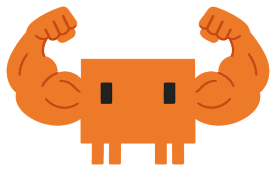
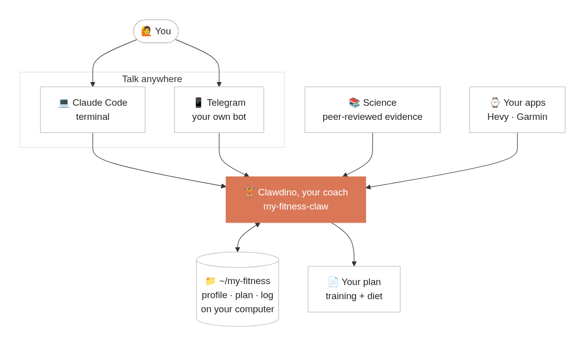
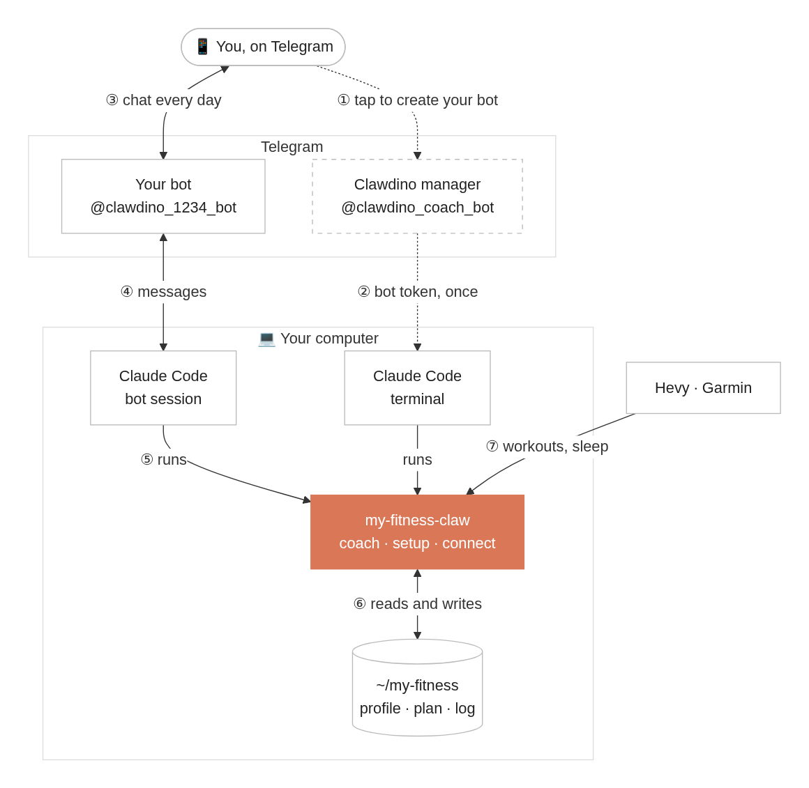

<p align="center">
  
</p>

<h1 align="center">Clawdino</h1>

<p align="center">
  Your science-based AI gym bro, on Claude Code and Telegram.<br>
  What works, as simple as possible, for you.
</p>

<p align="center">
  <a href="LICENSE"></a>
  
  
</p>

## Start with one message

Clawdino is the my-fitness-claw plugin.
You need [Claude Code](https://claude.com/claude-code), in a terminal or in the Claude desktop app's Code tab, with a paid Claude plan or an API key.
On Windows, also install [Git for Windows](https://git-scm.com/downloads/win); Telegram there needs a Linux server, and Windows is untested so far: tell us how it goes.
Paste this into Claude Code:

```
Install the my-fitness-claw plugin from github.com/pablo-aa/my-fitness-claw, then follow its setup skill to set me up
```

Em português:

```
Instale o plugin my-fitness-claw de github.com/pablo-aa/my-fitness-claw e depois siga a skill de setup dele para me configurar
```

That's it.
If Clawdino doesn't start, type `/reload-plugins` and say "set me up".
Clawdino asks where you want to talk: Telegram on your phone, or right here in Claude Code.
Pick Telegram, sign in to Claude in your browser if it asks, then scan a QR code and tap twice on your phone.
A few minutes later Clawdino texts you there (the first time, it installs what Telegram and voice messages need, see [What gets installed](#what-gets-installed)).
It gets to know you in a short chat, shows you the road to your goal and hands you your plan as a PDF.

<details>
<summary>Manual install</summary>

```
claude plugin install my-fitness-claw --marketplace pablo-aa/my-fitness-claw
```

Then open Claude Code and say "set me up".

</details>

## How it works

<p align="center">
  
</p>

**1. It gets to know you.**
A short conversation, not a form, with buttons when there are only a few answers.
In a hurry?
Say so and it skips straight to your plan.
Already have a plan from a coach or an app?
Send it as text, a photo or a PDF: Clawdino keeps it and suggests at most two changes.

```
┌─ Sam · fitness profile ────────────────┐
│          _                             │
│         /"\          GRINDER           │
│        /o o\         2 years, no       │
│   _\/  \   /  \/_    method            │
│    \\._/  /_.//                        │
│    `--,  ,----'                        │
│      /   /                             │
├────────────────────────────────────────┤
│                                        │
│ goal      -3 kg by Jun 1               │
│                                        │
│ body      F · 31 · 1.65m · 64kg        │
│                                        │
│ schedule  4x 45min · gym               │
│                                        │
│ diet      eats out at lunch            │
│                                        │
│ limits    lower back (old)             │
│                                        │
│ prefers   cycling                      │
│                                        │
└────────────────────────────────────────┘
```

**2. You get your plan.**
Training and diet on two printable pages, in plain words.

**3. You just talk.**
On Telegram, or in Claude Code, best opened in your `~/my-fitness` folder:

```
> 64.2
64.2, logged. Lowest of the month, by the way.

> had pizza for dinner with the team
Good, that's part of the deal. Normal day tomorrow, nothing to make up.

> squat felt heavy today
Normal after 4 days in a deficit. Keep the weight, same reps. Sleeping ok?
```

No message about food means you followed the plan.
Plans change? "I'm traveling this weekend" moves your sessions until you're back.
Once a week it reviews your progress and adjusts the plan if needed: on Telegram by itself, in Claude Code when you next open it.
It remembers you, not only your numbers: the trip you mentioned, the knee that hurt, how you like to be talked to.
Everything stays yours to change: the plan, your level, or a whole new plan of your own.

## Telegram

A bot just for you, created in a few taps: no BotFather, no tokens to copy.
Text it or send a voice message; most replies come in seconds.

<p align="center">
  
</p>

- **① ②** Once: you tap to create your bot, and the Clawdino manager hands its token to your computer.
- **③ to ⑦** Every day: messages go straight between Telegram and your computer, where Claude Code runs Anthropic's official [Telegram plugin](https://github.com/anthropics/claude-plugins-official/tree/main/external_plugins/telegram) and this coach.
- Voice messages are transcribed on your computer too, after a one-time download of about 500 MB.
- Check-ins, if you want them: the day's training every morning and a review of your week on Monday.
- It runs on macOS or Linux and answers while your computer is on and awake.
  To have it on all the time, or on Windows, put it on [your server](#on-all-the-time-on-your-server).
- After a restart of your computer or an update of the plugin, open Claude Code in `~/my-fitness` and Clawdino offers to start the bot again.
- Prefer a bot no one else manages?
  Ask to "use BotFather" and create the bot yourself.

## On all the time, on your server

Have a Linux server, like a small VPS you reach with `ssh` and a key, no password?
Set up Clawdino on your computer first, then ask it to "move my coach to my server".
It checks the server, installs what it needs there, asks you to sign in to Claude there once with one command, and moves your folder and your bot.

- From then on the coach lives only there, and the bot starts again by itself after a reboot.
  Nothing syncs: the copy on your computer stays as a record.
- 1 GB of memory is enough (the bot uses about 600 MB); voice messages need about 2 GB.
- Garmin doesn't move with it, so send screenshots instead; with no browser there, the plan comes as a page you print from the phone.
- Claude Code on your computer then only checks on it: ask it to see how the bot is, update it, open a session there, or "bring my coach back".

## Connections

Ask anything like "can you see my sleep?" or "connect my Hevy", and Clawdino shows what it can connect.
Connections are set up in Claude Code, not from Telegram.

| Connection | Brings |
|---|---|
| Telegram | Clawdino on your phone, voice notes included. |
| [Hevy](https://www.hevyapp.com) (Pro) | Your workouts and routines, pulled by itself. |
| Garmin | Steps, sleep, resting heart rate and weight, through [garmin_mcp](https://github.com/Taxuspt/garmin_mcp). |
| Any other watch | Send a screenshot of the day in its app. |

Already use a health MCP (Oura, ...)?
Ask "connect my watch" and the coach uses it.
Want every brand at once?
Self-host [open-wearables](https://github.com/the-momentum/open-wearables) and add its MCP.

## Three levels

Same science, different resolution.

```
                              _
                             /"\               _,     ,_
                            /o o\            .'/  ,_   \'.
     __                _\/  \   /  \/_      |  \__( >__/  |
   <(o )___             \\._/  /_.//        \             /
    ( ._> /             `--,  ,----'         '-..__ __..-'
     `---'                /   /                   /_\

     pupil                 grinder               maxxer
```

- **pupil**: new to the gym, simple rules, nothing to count.
- **grinder**: has trained and dieted before, now with a method and a few key numbers.
- **maxxer**: consistent and advanced, full numbers and weekly adjustments.

The coach figures out your level from your history, and moves you up as you progress.
See yourself somewhere else?
Just say so.

## Backed by science, not bro science

Every recommendation comes from [`evidence/`](evidence/): position stands and meta-analyses, every number checked against the paper.
You will never have to read it.
The coach only cites a study when you ask why.

## Your data

Everything lives in `~/my-fitness` (a `my-fitness` folder in your home folder), plain Markdown and CSV with git history.
Your files stay on your computer, or on your own server if you move them there; the Clawdino manager never sees them.
Like any Claude Code session, what Claude reads while you talk goes to Anthropic to get an answer.
On Telegram, messages go between Telegram's servers and your computer (or your server).
The Clawdino manager only helps create your bot; as its manager it could later fetch or replace the token, and it doesn't ([how it works](server/README.md)).

### Usage stats

If you say yes during setup, once a day per channel (terminal, Telegram) the plugin tells the Clawdino manager at `clawdino.pabloaa.com` that your install was used:

```json
{"id":"<random>","day":"2026-06-01","channel":"telegram","v":"0.2.0"}
```

Nothing else, never what you say.
Like any web request, the manager sees your IP address, and keeps it only in memory, briefly, to limit abuse.
To turn it off, ask the coach or set `- Usage stats: off` in `profile.md`.

## What gets installed

Nothing needs `sudo`, everything stays in your home folder, and each piece is installed only when you pick what needs it.
On a server, basics it lacks (like `unzip`) are the one thing you install yourself.

| What | When | Where |
|---|---|---|
| This plugin | always | `~/.claude/plugins` |
| Your fitness folder | always | `~/my-fitness` |
| [Bun](https://bun.sh) and Anthropic's Telegram plugin | Telegram | `~/.bun`, `~/.claude/plugins` |
| Your bot's token and access list | Telegram | `~/.claude/channels/telegram` |
| [uv](https://docs.astral.sh/uv/) and a speech model (about 500 MB) | voice messages | `~/.local/bin`, uv's and Hugging Face's caches |
| [garmin_mcp](https://github.com/Taxuspt/garmin_mcp) | Garmin | uv's cache, `~/.garminconnect` |
| Claude Code, Bun, the two plugins, your folder and bot, and a line in your crontab to start the bot after a reboot | a server | the server's home folder |

The plan PDF uses a browser you already have (Chrome, Edge, Brave or Chromium); none is installed.

<details>
<summary>Uninstall</summary>

First ask Clawdino to stop the Telegram bot, or stop `fitness-telegram` from `claude agents`.
On a server, ask Clawdino to bring the coach back first, or stop the bot there and remove its line (`# my-fitness-claw bot`) with `crontab -e`.
Then, in a terminal (Git Bash on Windows):

```sh
claude plugin uninstall my-fitness-claw
claude plugin uninstall telegram@claude-plugins-official
claude mcp remove --scope user garmin
rm -rf ~/.claude/channels/telegram ~/.garminconnect
```

Bun (`~/.bun`) and uv (`uv cache clean`, then `~/.local/bin/uv*`) can go too if nothing else uses them.
Your data stays in `~/my-fitness` until you delete it.

</details>

## FAQ

**What do I need?**
Claude Code with any paid Claude plan or an API key.
For Telegram, macOS or Linux, or a Linux server.
On a Team or Enterprise plan, an admin must enable channels first: Clawdino checks your account before installing anything, and offers to sign in with a personal account instead.
The bot runs in the background with Claude Code's own login, which the desktop app doesn't share.
If you only use the app, the setup opens a browser page once for you to sign in.
On Windows, Clawdino needs [Git for Windows](https://git-scm.com/downloads/win), since Claude Code runs the plugin's hooks with its Git Bash.

**Does it replace a dietitian or a coach?**
No.
It is a starting point that keeps you consistent.
If you have an illness, an injury or frequent pain, see a professional.

**Can I change the plan?**
Just ask, any part of it, or send a plan of your own.
It updates your files and your PDF.

**How do I stop the Telegram bot?**
Ask Clawdino in Claude Code, or stop `fitness-telegram` from `claude agents`.

## Develop

| Path | What it is |
|---|---|
| `skills/` | What Clawdino does: `setup`, `coach` (with `voice.md`, how it sounds, and `telegram.md` for the bot) and `connect` (one guide per connection). |
| `hooks/` | Plain `sh`: first-run nudge, Telegram context and voice transcription before the model, daily usage ping. |
| `scripts/` | `bot.sh` starts and stops the Telegram bot, `ask.sh` sends it tap-to-answer buttons, `test.sh` runs the offline checks. |
| `server/` | The Clawdino manager, a dependency-free Node service ([README](server/README.md)). |
| `evidence/` | The science base every recommendation comes from. |
| `template/` | The fitness folder copied for each new user. |
| `test/` | Fixtures for `test.sh`, a set-up folder (`fixtures/marina`), and personas with the simulator that plays them. |

- Run your working copy with `claude --plugin-dir .` from any folder.
- Run `sh scripts/test.sh` before a pull request: it checks the hooks, the scripts and the server, offline.
  It needs Node 20+ and curl; `MFC_TEST_VOICE=1` adds the voice check, which downloads a ~500 MB model once.
- Changed a skill?
  Watch a persona go through it: `node test/simulate.mjs test/personas/<name>.md --watch` plays them through a real Claude Code session.
  It needs tmux, and costs tokens; `--watch` opens a macOS Terminal window.
  With `--telegram` it runs the session like the bot and sends real messages through your own bot, to you; it stops your bot and drops its unread messages first.
  `--folder test/fixtures/marina` starts from a finished setup, for daily use (`test/personas/marina.md`).
  `--permission-mode auto --no-login` plays a desktop app user, whose Claude Code has no login yet (`test/personas/dani.md`).
- Writing rules: English, one sentence per line in Markdown, examples use the fictional user Sam; personas in `test/` may use other names and languages.
- A release bumps `version` in `.claude-plugin/plugin.json`; that is how users get the update.

## Contributing

Issues and pull requests are welcome.
Changes to `evidence/` need a source with a DOI, ideally a position stand or a meta-analysis.

## License

[MIT](LICENSE)
