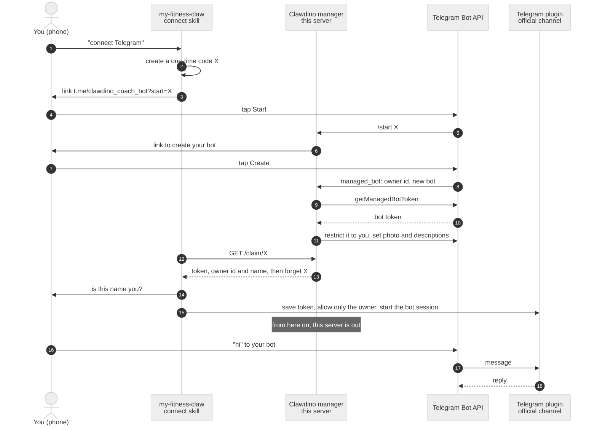

# Clawdino manager

The small service behind "connect Telegram".
It creates each user's own Telegram bot through [managed bots](https://core.telegram.org/bots/features#managed-bots) and hands the bot's token to the user's computer, once.
After that it is out of the loop: messages go straight between Telegram and the user's computer.

## How it works



## What it keeps

- **In memory:** each one-time code with its owner, forgotten a week after it expires.
  The bot token and the owner's Telegram name wait there at most 10 minutes, and are deleted once claimed.
- **In `events.jsonl`:** setup steps (`start`, `created`, `claimed`, `orphan`) with a hashed user id, and the anonymous usage pings.
  Never tokens, names or message content.

The manager stays the managing bot of every bot it created, so it could fetch or replace their tokens later.
It never does: the code above is all it runs.
If you prefer not to trust it, run your own manager (below) or use your own bot from @BotFather (see `skills/connect/telegram.md`).

## Endpoints

| Endpoint | Returns |
|---|---|
| `GET /claim/<code>` | `200` with `{token, owner_id, owner_name, username}` once, `404` until the bot exists, `410` once used or expired. |
| `POST /ping` | `204` for a valid `{id, day, channel, v}`, `400` otherwise. |
| `GET /health` | `200` with `{bot}`, the manager's username, or `503` while it starts. |

Every IP gets 60 requests a minute.

## Run your own

1. Create a bot with @BotFather and turn on Bot Management Mode in its mini app.
2. Run it with Node 20 or newer, behind HTTPS:

   ```sh
   CLAWDINO_TOKEN=<token> PORT=8787 TRUST_PROXY=1 node server/clawdino.mjs
   ```

3. Point the plugin to it with `CLAWDINO_URL=https://<your host>` in the environment of your Claude Code sessions.

It listens on `127.0.0.1` only; put nginx or Caddy in front, setting the client's address in `X-Real-IP` (nginx: `proxy_set_header X-Real-IP $remote_addr;`, Caddy: `header_up X-Real-IP {remote_host}`).
`TRUST_PROXY=1` makes the rate limit use that header; leave it out when nothing sets it, or anyone could forge it.
Turn off the proxy's access log for this host, so no IP addresses are kept.
